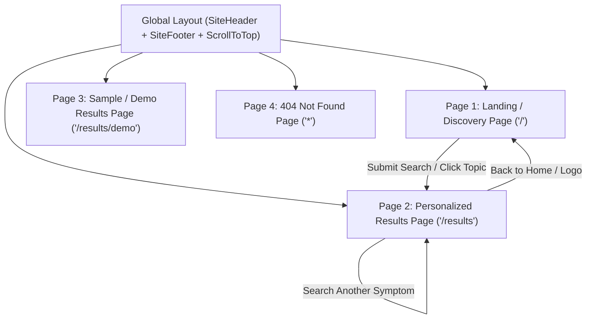
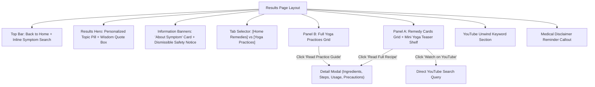

# AAROGYAM AI — Complete Frontend Design & Product Specification

> **Document Purpose**: This document provides a comprehensive, end-to-end design and functional specification for **AAROGYAM AI**. It details every page, route, visual component, user interaction, data schema, and API contract. A UI/UX designer and frontend developer can use this specification to craft a brand-new, completely redesigned frontend while maintaining 100% feature and data compatibility.

---

## 1. Brand Identity & Product Overview

### 1.1 Brand Overview
- **Product Name**: AAROGYAM AI (आरोग्यम् - Sanskrit for *Overall Well-Being & Freedom from Disease*)
- **Tagline**: *Ancient Wisdom. Intelligent Wellness.*
- **Mission**: To bring traditional Ayurvedic home comfort perspectives and gentle yoga practices together with artificial intelligence, empowering users with supportive, natural lifestyle ideas for common daily discomforts.
- **Vedic Philosophy**: “स्वस्थस्य स्वास्थ्य रक्षणम्” (*"Protecting and nurturing the health of the healthy"* — *Charaka Samhita*).
- **Core Emotional Tone**: Serene, trustworthy, soothing, warm, organic, elevated, non-clinical.

### 1.2 Medical Boundary & Safety Non-Negotiables
- **Non-Diagnostic**: AAROGYAM AI **never** provides diagnoses, medical treatment plans, or clinical cures.
- **No Prescription Claims**: Remedies are labeled as *"Gentle home support"* and *"Small comforts"*, not cures.
- **Emergency Interception**: Serious or acute red-flag symptoms (chest pain, stroke signs, severe breathlessness) are intercepted with urgent medical care warnings before AI processing.
- **Everyday Kitchen Quantities**: Remedies only use safe, common kitchen ingredients with everyday measures (*"a pinch"*, *"1 cup"*, *"a small spoonful"*). No clinical dosage units (mg, ml) or frequencies (*"take 3 times a day"*).

---

## 2. Information Architecture & Page Inventory

The web application contains **4 distinct routes / pages** plus persistent global layout elements:



| Route | Page Name | Primary Purpose | Key State / Props |
|---|---|---|---|
| `/` | **Landing Page** | First impression, symptom search, how it works, categories, philosophy | `isSearching`, `searchError`, search input query |
| `/results` | **Personalized Results Page** | Displays AI-generated remedies, yoga poses, summaries, and video search links | `location.state.guide` (API payload from search) |
| `/results/demo` | **Demo / Sample Guide** | Instant preview of the results experience without requiring an active API key | Built-in fallback `mockWellnessGuide` (Common Cold) |
| `*` | **404 Page** | Graceful fallback when navigating to non-existent URLs | Link back to `/` |

---

## 3. Persistent Global Components

### 3.1 Global Header (`SiteHeader`)
- **Positioning**: Sticky or fixed top navigation bar with translucent backdrop blur (glassmorphism).
- **Brand Logo (`LotusLogo`)**:
  - Lotus Flower emblem (symbolizing purity, life, and natural harmony) rendered in warm gold/amber gradient.
  - Wordmark: **AAROGYAM AI** with subtle sub-label: *Ancient Wisdom. Intelligent Wellness.*
  - Clicking the logo resets search focus and navigates to `/`.
- **Desktop Navigation Links**:
  - `Home` (`/`)
  - `How It Works` (Smooth anchor scroll to `#how-it-works`)
  - `Wellness Library` (Smooth anchor scroll to `#wellness`)
  - `About / Philosophy` (Smooth anchor scroll to `#about`)
- **Mobile Responsive Drawer**:
  - Hamburger toggle button (`Menu` icon) that transforms into `X` (close icon) when expanded.
  - Accessible drawer opening with animated slide-in or fade-down menu.
  - Automatically closes upon route or anchor selection.

### 3.2 Global Footer (`SiteFooter`)
- **Top Row**:
  - Lotus emblem and brand wordmark.
  - 3 Feature Badges:
    - 🌿 *Natural Remedies*
    - 🧘 *Yoga for Wellness*
    - 💚 *Healthy Living*
- **Divider Line**: Subtle warm hairline accent.
- **Bottom Row**:
  - **Medical Disclaimer**:
    > *"AAROGYAM AI provides educational wellness guidance and does not offer medical diagnoses or prescriptions. Always seek advice from a licensed medical practitioner for health concerns."*
  - **Footer Links**: About, Wellness Library, and dynamic copyright year (*© 2026 AAROGYAM AI*).

### 3.3 Scroll-to-Top Controller (`ScrollToTop`)
- Automatically resets window scroll position to `(0, 0)` on every route transition.

---

## 4. Page 1: Landing Page (`/`) Detailed Specification

The landing page serves as the user's sanctuary. It is designed to immediately establish calm, trust, and clarity.

### Section 4.1: Cinematic Hero & Interactive Search (`HeroSection`)
1. **Background Visual & Ambiance**:
   - Central meditating yogi figure set within an ancient stone temple sanctuary bathed in warm mountain sunlight.
   - Ambient gradient vignettes and a sacred golden aura radial gradient behind the yogi.
2. **Cinematic Zoom & Blur Interaction**:
   - **Default State**: Clear central yogi, soft golden gradients, floating search bar.
   - **Search Focused State** (`searchFocused: true`):
     - When the user focuses or clicks inside the search input, the background image **zooms in smoothly (1.08x scale)** and receives a **soft Gaussian blur (4px)**.
     - A dark scrim overlay intensifies to create contrast and focus, bringing the search capsule and quick chips to the immediate foreground.
3. **Hero Typography & Badge**:
   - Top Badge: `"ANCIENT WISDOM · INTELLIGENT WELLNESS"` with a pulsing golden dot.
   - Main Heading (H1):
     ```
     Ancient Wisdom.
     Intelligent Wellness.
     ```
   - Subtitle: *"Discover natural wellness guidance through the wisdom of Ayurveda, yoga and the power of AI."*
4. **Hero Search Capsule (Core Interaction)**:
   - Capsule shape with rounded corners, warm glassmorphic background, subtle border glow.
   - **Search Magnifier Icon**: Left-aligned.
   - **Search Input Field**:
     - Accessible label: *"What are you feeling today?"*
     - Placeholder text: *"What are you feeling today?"*
     - Maximum character count: 180 characters.
   - **Submit Button**:
     - Circular submit button with forward arrow (`ArrowRight`).
     - Disabled during active search.
     - Hover & active micro-interactions.
   - **Active Searching State**:
     - Shows animated rotating sparkles icon (`Sparkles`).
     - Feedback text: *"Consulting Ayurvedic wisdom & AI..."*
   - **Error Alert Banner**:
     - Displays inline if API fails, rate-limits, or validation fails (e.g., *"Please enter a symptom between 1 and 180 characters"*).
5. **Quick-Search Topic Chips ("Try searching for:")**:
   - Label framed with delicate dashed lines: `— Try searching for: —`
   - Row of 6 quick-suggestion chips:
     1. 🧠 **Headache**
     2. 🫁 **Cough**
     3. 🦴 **Back Pain**
     4. 🧘 **Stress**
     5. 🫄 **Acidity**
     6. ❄️ **Common cold**
   - **Interaction**: Clicking any chip instantly fills the input field, shifts focus, and triggers search execution.

---

### Section 4.2: "How AAROGYAM AI Works?" (`#how-it-works`)
- **Header**: Ornate header with classical swags: `~ • ~ How AAROGYAM AI Works? ~ • ~`
- **3-Step Horizontal Process Flow** (connected with right arrows):
  1. **Step 1: Search**
     - Icon: Magnifier (`Search`) inside emerald circular badge.
     - Subtitle: *"Enter your health concern"*
  2. **Step 2: Discover**
     - Icon: Mind/Brain (`Brain`) inside purple/amethyst circular badge.
     - Subtitle: *"Get AI-powered remedies & yoga"*
  3. **Step 3: Heal**
     - Icon: Heart (`Heart`) inside peach/terracotta circular badge.
     - Subtitle: *"Follow the natural path to wellness"*

---

### Section 4.3: "Wellness Categories" (`#wellness`)
- **Header**: Ornate section header framed by Ayurvedic leaf flourishes: `🌿 Wellness Categories 🌿`
- **Sub-headline**: *"A little care, in many forms."*
- **4 Circular Pillar Cards**:
  1. 🥣 **Ayurveda** — *Natural Healing* (Green accent)
  2. 🧘 **Yoga** — *Mind & Body* (Peach accent)
  3. 🌿 **Home Remedies** — *Simple & Effective* (Amber accent)
  4. 💚 **Healthy Living** — *Live Better* (Emerald accent)

---

### Section 4.4: "Our Philosophy" (`#about`)
- **Visual Card**: Warm parchment card with ornate borders.
- **Content**:
  - Eyebrow: `OUR PHILOSOPHY`
  - Heading: *"Ancient roots. A more mindful today."*
  - Body Text: Contextualizing traditional herbal remedies as complementary comforts, never substitutes for emergency medicine.
  - Sanskrit Verse Callout:
    ```
    स्वस्थस्य स्वास्थ्य रक्षणम्
    ```
  - English Translation: *“Protecting and nurturing the health of the healthy.”*

---

## 5. Page 2 & 3: Results Page (`/results` & `/results/demo`) Detailed Specification

This page presents the tailored wellness guide. If accessed directly without search state, it redirects to `/` unless accessing `/results/demo`, which displays the built-in sample guide.



---

### Section 5.1: Top Navigation & In-Page Re-Search Bar
- **Back to Home Action**: Left-aligned back button with arrow (`ArrowLeft`) returning to `/`.
- **Inline Search Capsule**:
  - Allows the user to search a different symptom without returning to the landing page.
  - Contains search icon, input field (`placeholder="Search another symptom..."`), and a `Search` submit button.
  - Disables and indicates loading while submitting new queries.

---

### Section 5.2: Results Hero & Wisdom Quote
- **Left Column (Guide Overview)**:
  - Sparkle pill: `✨ Your Wellness Guide`
  - Heading (H1): *"Caring for your health, naturally. A gentle guide for [symptom]."*
  - Query Tag:
    - Chip displaying `🔍 [Symptom Name]` with an `X` clear button that routes back home.
  - Metadata Stamp:
    - `SAMPLE GUIDE · NOT PERSONALIZED` (if on `/results/demo`)
    - `AI-GENERATED GUIDE · NOT PERSONALIZED` (if on `/results`)
- **Right Column (Wisdom Callout Box)**:
  - Background watermarked with lotus silhouette.
  - Inspirational quote: *“A healthy mind leads to a happy life.”*
  - Author attribution: *— AAROGYAM AI*

---

### Section 5.3: Dual Information Banners
Two balanced cards placed side-by-side above the recommendation tabs:
1. **About [Symptom] Card**:
   - Blue/slate circular icon with `Info` icon.
   - Title: `About [Symptom]`
   - Body: 2–3 sentence overview of why the symptom occurs and general supportive lifestyle principles.
2. **Safety Notice Card** (Dismissible):
   - Amber circular icon with `AlertTriangle` / `CircleAlert` icon.
   - Title: `Safety Notice`
   - Dismiss Button: Top-right `X` button to hide the banner.
   - Body: Explicit safety instructions (e.g., *"If symptoms are severe, sudden, or accompanied by high fever, consult a healthcare professional immediately."*).

---

### Section 5.4: Tab Selector
- **Tab 1: Home Remedies**
  - Icon: Leaf (`Leaf`)
  - Label: `Home Remedies`
  - Pill Counter: Displays number of remedies (e.g., `3`)
- **Tab 2: Yoga Practices**
  - Icon: Yoga posture emoji (`🧘`)
  - Label: `Yoga Practices`
  - Pill Counter: Displays number of yoga poses (e.g., `2`)
- **Active Tab Styling**: Distinct elevated card appearance with accent underline and high-contrast styling.

---

### Section 5.5: Home Remedies Cards Grid (`RemedyCard`)
Displays 2 to 5 modern cards of **equal height and structured layout**:
1. **Clickable Media Banner**:
   - High-quality contextual photo (ginger tea, tulsi leaves, warm steam, etc.) with local fallbacks.
   - **Hover Play Overlay**: Translucent dark overlay with central circular `Play` button and *"Watch Video"* label. Clicking opens the YouTube video search.
   - **Corner Badges**:
     - Time badge: `⏱ 5 mins`
     - Nature badge: `🌿 Natural`
2. **Card Header**:
   - Clickable Title (links to YouTube search).
   - 1-sentence supportive subtitle.
3. **Card Body (Highlights)**:
   - Ingredient tags shelf: First 3 ingredients in soft pills (e.g., `Ginger`, `Honey`, `Warm Water`) plus `+1 more` if exceeding 3.
4. **Primary Action**:
   - **"Read Full Recipe"** button with book icon (`BookOpen`) and forward arrow. Opens the comprehensive `DetailModal`.
5. **Card Footer (Video Bar)**:
   - Video channel credit (`Healthy Tips` or `Ayurveda for Life`).
   - Video duration indicator (`0:32`).
   - YouTube button (`YouTubeIcon` + *"Watch on YouTube"*) opening a relevant tutorial on YouTube in a new tab.

---

### Section 5.6: Mini Yoga Teaser Shelf (Inside Remedies Tab)
- Located directly beneath the remedy cards on the remedies tab to tease gentle physical movement.
- Section Header: `GENTLE MOVEMENT FOR [TOPIC] - Yoga for [Topic]`
- Sub-text: *"Try these gentle yoga poses for relief."*
- Action Link: **"View All Yoga →"** (clicking automatically switches active tab to Yoga).
- Shows preview cards of the first 2-3 yoga postures.

---

### Section 5.7: Full Yoga Practices Grid (`YogaCard`)
Displays gentle poses (Child's Pose, Neck Stretch, Pranayama, etc.):
1. **Clickable Media Banner**:
   - Pose imagery with play overlay and badges (`⏱ 5-10 mins`, `🧘 Gentle`).
2. **Card Header**: Pose name in English & Sanskrit (e.g., *Child Pose (Balasana)*) + short summary.
3. **Card Body (Highlights)**:
   - Tags: `🧘 N Steps`, `⏱ Duration`, `✓ Pain-free`.
4. **Primary Action**:
   - **"Read Practice Guide"** button opening the `DetailModal`.
5. **Card Footer**:
   - Channel label (`Yoga & Breath`), duration indicator (`Guided`), and green **"Watch on YouTube"** button.

---

### Section 5.8: Recipe & Practice Detail Modal (`DetailModal`)
A modal dialog triggered when clicking *"Read Full Recipe"* or *"Read Practice Guide"*:
- **Modal Mechanics**:
  - Centered dialog with dark frosted backdrop (`recipe-modal-backdrop`).
  - Closes on `Escape` key, backdrop click, top-right `X` button, or bottom *"Done"* button.
  - Traps focus and disables background page scrolling while open.
- **Modal Header Banner**:
  - Panoramic recipe/yoga hero image with gradient overlay.
  - Floating badges for duration and practice type.
  - Full title and summary description.
- **Modal Body Sections**:
  - **Remedy View**:
    1. *WHAT YOU'LL NEED*: Grid of ingredient cards displaying ingredient name + everyday household quantity (e.g., `✓ Fresh Ginger — 1 small piece`).
    2. *PREPARATION*: Numbered step-by-step preparation list.
    3. *USAGE DIRECTIONS*: Guidance on how to consume or apply (e.g., *"Sip slowly while warm"*).
    4. *PLEASE NOTE* (Warning Box): Precautions (e.g., allergy notices, age warnings like *"Never give honey to infants under 1 year"*).
  - **Yoga View**:
    1. *TRY IT GENTLY*: Numbered step-by-step postural and breathing instructions.
    2. *SAFETY FIRST* (Warning Box): Clear guidance to discontinue if pain, dizziness, or strain occurs.
- **Modal Footer Actions**:
  - Green *"Watch Video Tutorial on YouTube"* button with YouTube logo.
  - Secondary *"Done"* dismiss button.

---

### Section 5.9: "Watch & Unwind" YouTube Inspiration Shelf
- Headline: `A LITTLE INSPIRATION - Watch & unwind`
- Description: *"Choose a keyword card to search YouTube. Results are external and aren't medical endorsements."*
- **3 Visual Keyword Cards**:
  1. *Warrior Pose for [Topic]*
  2. *Seated Yoga for Relaxation*
  3. *Gentle Side Stretch*
- Each card features custom yoga pose vector illustrations, a play icon badge, and opens pre-curated YouTube video searches.

---

### Section 5.10: Bottom Medical Safety Notice
- Lead: Shield icon + **"A gentle reminder:"**
- Copy: *"AAROGYAM AI provides lifestyle comfort suggestions and traditional Ayurvedic ideas. It does not provide medical diagnoses or prescriptions. If symptoms worsen, persist, or feel severe, please consult a qualified healthcare provider."*

---

## 6. Page 4: 404 Not Found Page (`*`)

- **Tone**: Quiet, minimal, non-frustrating.
- **Content**:
  - Eyebrow line: `AAROGYAM AI`
  - Headline: *"That path isn’t here."*
  - Subtitle: *"Let’s return to a quieter starting point."*
  - CTA Button: `← Back to home` (links to `/`).

---

## 7. Data Models & API Contracts

### 7.1 Backend Search API
- **Endpoint**: `POST /api/search`
- **Headers**: `Content-Type: application/json`
- **Request Body**:
  ```json
  {
    "query": "mild throat irritation"
  }
  ```
- **Validation Constraints**: String, trimmed, 1 to 180 characters.

### 7.2 Successful Guide Response (`HTTP 200`)
```json
{
  "query": "mild throat irritation",
  "summary": "Gentle throat irritation is often soothed with warmth, gentle hydration, and moist air.",
  "safetyNote": "This is general wellness information, not a diagnosis or treatment plan. Do not stop or replace care from a qualified health professional. Seek urgent care for severe, rapidly worsening, or emergency symptoms.",
  "remedies": [
    {
      "title": "Warm Honey & Turmeric Water",
      "summary": "A soothing, traditional Ayurvedic warm drink to coat and comfort the throat.",
      "ingredients": [
        { "name": "Warm water", "amount": "1 cup" },
        { "name": "Raw honey", "amount": "1 small spoonful" },
        { "name": "Turmeric powder", "amount": "a pinch" }
      ],
      "steps": [
        "Warm the water to a comfortable sipping temperature.",
        "Stir in the pinch of turmeric until dissolved.",
        "Add the spoonful of honey and stir gently."
      ],
      "usage": "Sip slowly throughout the morning or evening as comfortable.",
      "precautions": [
        "Do not give honey to infants under 1 year of age.",
        "Ensure the liquid is warm, not scalding hot."
      ]
    }
  ],
  "yoga": [
    {
      "title": "Gentle Seated Neck Rolls",
      "summary": "Slow movements to release tension around the throat, neck, and upper shoulders.",
      "duration": "3 min",
      "durationMinutes": 3,
      "steps": [
        "Sit comfortably with your spine tall and shoulders dropped.",
        "Gently tilt your right ear toward your right shoulder for three natural breaths.",
        "Slowly roll your chin toward your chest and repeat on the left side."
      ],
      "precautions": [
        "Do not roll your head backward.",
        "Stop immediately if you experience dizziness or sharp pain."
      ]
    }
  ],
  "videos": [],
  "sources": [],
  "historySaved": false,
  "historyStatus": "anonymous"
}
```

### 7.3 Emergency Red-Flag Response (`HTTP 422`)
Triggered automatically when queries contain emergency triggers (chest pain, stroke signs, difficulty breathing, suicide/self-harm):
```json
{
  "code": "urgent_care",
  "error": "These symptoms may need urgent attention. Contact your local emergency number or go to the nearest emergency department now. Do not wait for online wellness guidance."
}
```

### 7.4 Rate Limiting (`HTTP 429`)
- Maximum 20 searches per 15 minutes per IP address.
- Response includes `Retry-After: 900` header.

### 7.5 Health Check Endpoint (`GET /api/health`)
- Returns `HTTP 200`:
  ```json
  { "status": "ok", "service": "aarogyam-ai-api" }
  ```

---

## 8. Design System & Visual Guidelines for Redesign

A designer has the freedom to reimagine the layouts, shapes, typography, and card treatments. However, the following core aesthetic pillars define the AAROGYAM AI identity:

### 8.1 Color Palette Archetype
| Color Role | Vibe / Purpose | Recommended Tone |
|---|---|---|
| **Parchment / Sand Base** | Page background, calm warmth, organic paper | Creamy alabaster, soft linen, warm off-white (`#FDFBF7`, `#F9F6F0`) |
| **Ayurvedic Sage / Forest** | Nature, leaf remedies, health, life | Deep botanical green, muted sage, eucalyptus (`#2D5A43`, `#1E3A2B`) |
| **Golden Amber / Turmeric** | Vitality, warmth, spiritual light, accents | Warm marigold, golden turmeric, soft saffron (`#D97706`, `#B45309`) |
| **Terracotta / Peach** | Gentle movement, care, comfort badges | Warm clay, muted terracotta, dusty rose (`#E07A5F`, `#F4A261`) |
| **Deep Charcoal / Espresso** | Text hierarchy, optimal legibility | Espresso charcoal (`#1C1917`, `#292524`), softer than pure black |
| **Card Glass Surface** | Card containers, modal overlays | Semi-translucent white with 1px hairline borders (`rgba(255, 255, 255, 0.85)`) |

### 8.2 Typography Direction
- **Display / Headings**: A refined, classical serif that evokes heritage, wisdom, and timeless literature (e.g., *Cinzel*, *Playfair Display*, *Cormorant Garamond*, or *Fraunces*).
- **Body & Controls**: A legible, clean sans-serif designed for modern web apps (e.g., *Plus Jakarta Sans*, *Inter*, *Outfit*, or *Cabinet Grotesk*).
- **Italic Flourishes**: Selective use of editorial italics for secondary cues (e.g., *"Caring for your health, naturally."* or *"A little care, in many forms."*).

### 8.3 Interaction & Micro-Animations
- **Smooth Focus Transitions**: Backdrop blur and scale changes should use smooth cubic-bezier transitions (`transition: all 400ms cubic-bezier(0.16, 1, 0.3, 1)`).
- **Tactile Card Hover**: Subtle lift (e.g., `-3px` Y-transform) and gentle drop-shadow elevation.
- **Loading Skeleton**: Shimmer effect on placeholder cards matching card dimensions during active API queries.
- **Accessibility**: Full keyboard navigability, visible focus rings, ARIA labels for icon-only buttons, and WCAG AA color contrast compliance.

---

## 9. Summary Checklist for the Designer

When designing the new frontend, ensure your mockups include:
- [ ] **Home Page Desktop View** (Hero with Yogi artwork, center search capsule, topic chips, 3-step works section, 4 categories, philosophy card, header, footer).
- [ ] **Home Page Search Focused State** (Background zoom + blur scrim, elevated search bar).
- [ ] **Home Page Mobile View** (Mobile hamburger menu, stacked search and chips, responsive cards).
- [ ] **Results Page Desktop View** (Top navigation with in-page search bar, guide overview header, wisdom quote, About card, dismissible safety card, tab switcher).
- [ ] **Remedies Tab View** (Equal-height remedy cards with video thumbnails, ingredient chips, "Read Full Recipe" button, YouTube button, and mini Yoga shelf below).
- [ ] **Yoga Tab View** (Yoga cards with pose thumbnails, duration tags, "Read Practice Guide" button, YouTube button).
- [ ] **Recipe & Practice Detail Modal** (Full ingredients checklist with amounts, numbered preparation steps, usage, and safety note).
- [ ] **Urgent Care / Emergency Alert State** (High-visibility warning banner when red-flag symptoms are entered).
- [ ] **404 Page View** (Minimal, calming error screen with back link).
